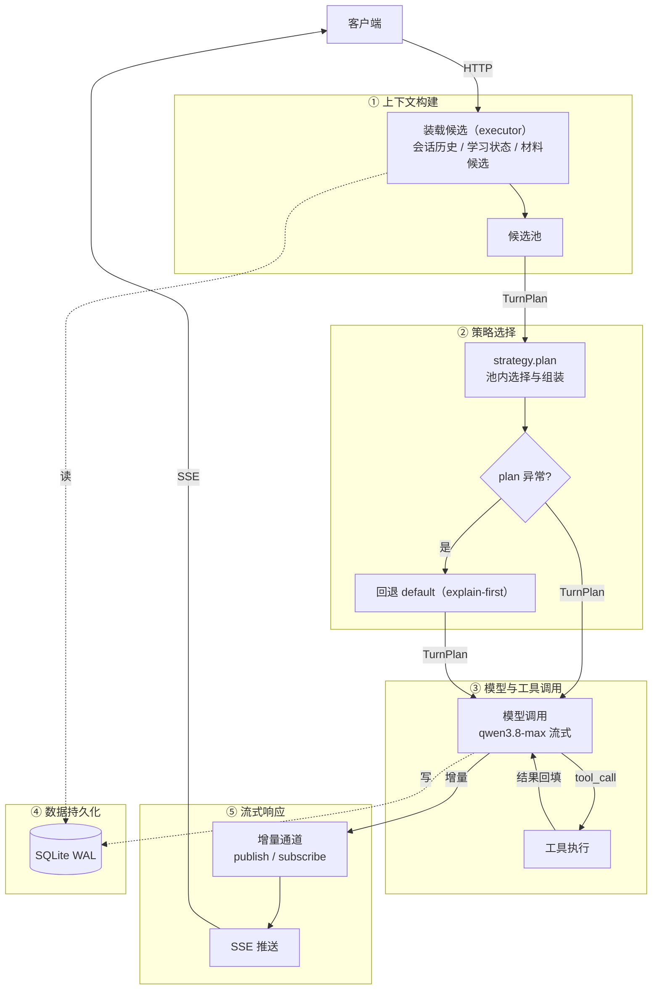

# Zero

## 架构图

**图注**

- **表结构**：messages / turns / model_calls / tool_calls / turn_context / learning_state / materials / worker_liveness / eval_runs 等表定义见 `docs/decisions.md`（D1/D8）。
- **取消**：显式 cancel 端点写 cancel_requested，owner 轮询中止 → interrupted(user_cancel)；断连不取消、后台继续至 completed。
- **恢复**：instance UUID + 心跳新鲜度回收 stale-owner 的 running 轮次 → interrupted，区分全量与滚动重启、不误杀兄弟进程。
- **评估**：eval_runs 以 run_id + seed_manifest_hash 标记两次运行，直读审计生成逐轮记录与策略对比表。
- **并发**：每对话至多一个 running（部分唯一索引）；同 client_msg_id 幂等去重，重试返回已有轮次。
