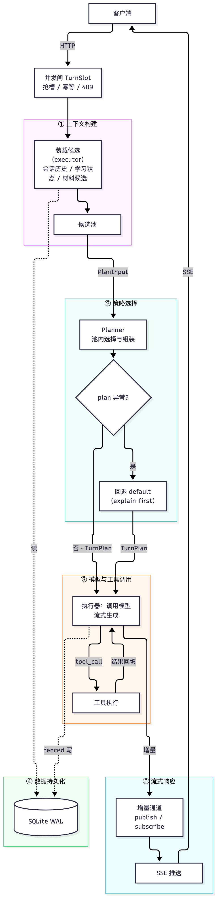

# Zero

学习陪伴场景作业：题目一架构设计 + 题目二 Agent 对话服务实现与评估。

- 需求清单：[docs/requirements.md](docs/requirements.md)
- 设计说明（题目一 1–5 问）：[docs/design-notes.md](docs/design-notes.md)
- 决策记录（D0–D8 + 实现细化）：[docs/decisions.md](docs/decisions.md)
- 评估报告（两跑对比与差异分析）：[eval/REPORT.md](eval/REPORT.md)

## 架构图（题目一）



> 图源码：[docs/architecture.mmd](docs/architecture.mmd)（唯一来源；改图后重渲染 PNG/SVG，见 docs/design-notes.md 链接）。

**图注**

- **表结构**：messages / turns / model_calls / tool_calls / turn_context / learning_state / materials / worker_liveness / eval_runs 等表定义见 `docs/decisions.md`（D1/D8）与 `src/agent/storage/schema.sql`。
- **取消**：显式 cancel 端点写 cancel_requested，owner 轮询中止 → interrupted(user_cancel)；断连不取消、后台继续至 completed。
- **恢复**：instance UUID + 心跳新鲜度回收 stale-owner 的 running 轮次 → interrupted，区分全量与滚动重启、不误杀兄弟进程；回收后 stale owner 写入被 fencing 拒绝。
- **评估**：eval_runs 以 run_id + seed_manifest_hash 标记两次运行，直读审计生成逐轮记录与策略对比表。
- **并发**：每对话至多一个 running（部分唯一索引）；同 client_msg_id 幂等去重，重试返回已有轮次。

---

## 题目二：运行指南

### 目录结构

```
src/agent/            服务代码（config/storage/slot/recovery/context/strategies/tools/executor/channel/model_client/api）
seeds/seed.json       预置用户/话题/材料片段/题库/学习状态（版本化种子）
scripts/              init_db.py（种子载入）、smoke_model.py（API 冒烟）、capture_tool_example.py（B7 证据）
tests/                自动化测试（存储层 + 真实 API + T5）
eval/                 cases.json / checks.json / harness.py / runs/（两跑归档）/ REPORT.md / evidence/
docs/                 需求、设计说明、决策记录、AI 使用记录
```

### 环境准备

Python ≥ 3.11（开发用 conda 环境 `zero`）。

```bash
pip install -r requirements.txt   # 锁定版本依赖
pip install -e . --no-deps        # 安装本包（agent）
```

### 模型 API 配置

```bash
cp .env.example .env              # 填入 API_KEY（勿提交 .env）
```

默认模型 `qwen3.8-flash`，端点 `https://maas.qianwenaiapi.com/compatible-mode/v1`（OpenAI 兼容）。可经环境变量覆盖：`AGENT_MODEL`、`AGENT_BASE_URL`、`AGENT_TEMPERATURE`、`AGENT_MAX_TOKENS`、`AGENT_TOP_P`、`AGENT_DB_PATH` 等（全量默认值见 `src/agent/config.py`）。评估的模型/参数一致性由单一配置源保证并随 run 记录。

### 启动

```bash
python scripts/init_db.py                          # 初始化+种子（幂等），打印 seed_manifest_hash
uvicorn agent.asgi:app --host 127.0.0.1 --port 8000   # 开发单进程
gunicorn agent.asgi:app -c gunicorn.conf.py        # 多进程形态（workers=2，UvicornWorker）
```

### 接口速览

| 接口 | 说明 |
|---|---|
| `POST /conversations` | 建会话（topic_id/user_id/strategy_name/strategy_version） |
| `PATCH /conversations/{id}/strategy` | 切换策略（注册表内 name@version） |
| `POST /conversations/{id}/messages` | 提交用户消息，SSE 流式返回；`client_msg_id` 幂等；对话忙等待超时 → **409 conversation_busy + Retry-After** |
| `GET /conversations/{id}/messages` | 完整历史：messages + turns 两块（轮次状态/planned/actual/fallback/token/耗时/工具数），按 msg_seq 确定顺序 |
| `GET /conversations/{id}/turns/{turn_id}` | 单轮完整审计（plan_doc/model_calls/tool_calls/turn_context） |
| `POST /conversations/{id}/turns/{turn_id}/cancel` | 显式取消（仅 running 有效，终态 no-op） |
| `GET /healthz` | 存活与 instance UUID |

SSE 事件：`turn_started` / `delta` / `tool` / 终止事件 `done`（completed）、`error`（failed+error_code）、`interrupted`（+reason）。

### 断线语义（A4/T2）

- **断连不取消生成**：生成是脱离请求的后台任务，SSE 只是订阅者；断开仅退订，轮次跑完 → `completed`，完整回复落库。
- **部分回复**：生成中节流（~500ms）UPDATE assistant 占位行，`is_partial=true`；完成同事务置最终内容 + `is_partial=false`。
- **重读历史**：running 轮次返回 partial（打标），completed 返回完整。同 `client_msg_id` 重试：终态→回放；本进程 running→实时订阅；跨 worker running→DB 轮询流（重连不丢视图，但无跨 worker 实时增量，见限制）。
- **显式取消**：cancel 端点写 DB 标志，owner 在 chunk 间检查中止 → `interrupted(user_cancel)`，保留 partial。
- **重启**：instance UUID + 心跳新鲜度回收孤儿 running → `interrupted(process_restart)`，保留 partial、释放槽；滚动重启不误杀兄弟进程。**fencing**：回收后 stale owner 的一切写入（终态/刷盘/审计）被条件写拒绝，不会复活轮次。

### 测试

```bash
python -m pytest tests                     # 全部（含真实 API，需 API_KEY；无密钥自动 skip）
python -m pytest tests -m "not real_api"   # 纯存储/逻辑（32 个，无需密钥）
python -m pytest tests -m real_api         # 真实 API 验收（T1/T2/T4/T5）
```

| 场景 | 测试 | 验证层 |
|---|---|---|
| T1 持久化与重启 | `test_real_api.py::test_t1_restart_persistence_and_orphan` | **真实服务进程 kill→重启**（completed 持久 + 孤儿回收） |
| T2 流式中断 | `test_real_api.py::test_t2_disconnect_background_continue` | 真实 API，断连→后台继续→completed |
| T3 并发写入 | `test_storage.py::test_t3_two_processes / _two_connections_race` | 两进程 + 两独立连接（题目允许存储层） |
| T4 策略切换/回退 | `test_real_api.py::test_t4_*` + `test_strategies.py` | 故障注入 app（仅注册 API 扩展）+ 单元 |
| T5 评估重复 | `test_eval_t5.py::test_t5_repeatable_eval` | harness 同配置两跑（真实 API） |

另有 fencing 拒绝、幂等、owner 感知回收、上下文窗口、工具判定等单元/存储测试。

### 评估

```bash
python eval/harness.py                    # 一次完整运行（4 用例×2 策略×3 轮，独立 DB+服务+臂用户）
python eval/harness.py --case case-1      # 小子集
python scripts/capture_tool_example.py    # 复跑 B7 工具调用证据
```

两次正式运行归档于 `eval/runs/`（逐轮记录/检查/汇总/对比表），跨 run 分析见 [eval/REPORT.md](eval/REPORT.md)。真实工具调用闭环证据见 `eval/evidence/`。

### 主要设计取舍

详见 `docs/decisions.md`（每项含候选、放弃原因与后果）。摘要：

- **SQLite(WAL) + 部分唯一索引抢槽** 而非 PostgreSQL advisory lock：零外部依赖、评审即跑；短事务抢槽、生成在事务外；PG 留作 50× 演进（并发原语 DB 无关，迁移不返工）。
- **策略 = 纯规划器**（无 IO/时钟/随机），只产出可序列化 TurnPlan；注册表 name→version→factory，新增策略零改动存储/HTTP/执行器；回退仅包裹 plan 构建+校验阶段。
- **审计即评估数据源**：model_calls/tool_calls（call_seq 统一单调）+ plan 文档 + turn_context 纯引用；评估直读 DB，执行与评估共用一套记录。
- **上下文纯引用**（删除指向空，擦除优先于复现）；完整历史 ≠ 模型上下文（token 预算+条数兜底、轮原子、排除 partial）。
- **可检验行为做成工具调用**（ask_question/provide_explanation/judge_answer），检查断言结构化记录而非自由文本启发式。
- **评估状态隔离**：每 run 独立 DB+服务实例，两臂独立用户（同预置学习状态）；seed_manifest_hash 证同种子。
- **fencing + owner 感知恢复**：心跳新鲜度区分全量/滚动重启；回收后 stale 写入全拒。

### 已知限制

- 跨 worker 重连无实时增量（生成任务与订阅队列在 owning worker 内存）；重连=GET/轮询流。演进：DB 轮询→PG NOTIFY/Redis Streams→独立生成层（2A→2B/2C→2E）。
- 行为检查依赖模型遵循指令调用工具；评估中 3 条失败源于"正文讲解未调工具"与"答案键精确匹配误判半答案/异措辞"（REPORT.md 第 3、5 节）。演进：LLM-as-judge、更宽答案键。
- SQLite 单机单写者；50× 需先换 PG 共享权威状态。
- 进程内流缓冲存活于进程生命周期（Q2 规模无碍）；未做分页、删除接口、文件上传解析、生产级认证（题目豁免）。
- 学习状态为静态预置 digest（judge_answer 追加 answer_events，digest 不更新）；更新逻辑留作演进。

### AI 使用记录

见 [docs/ai-usage/](docs/ai-usage/)。
